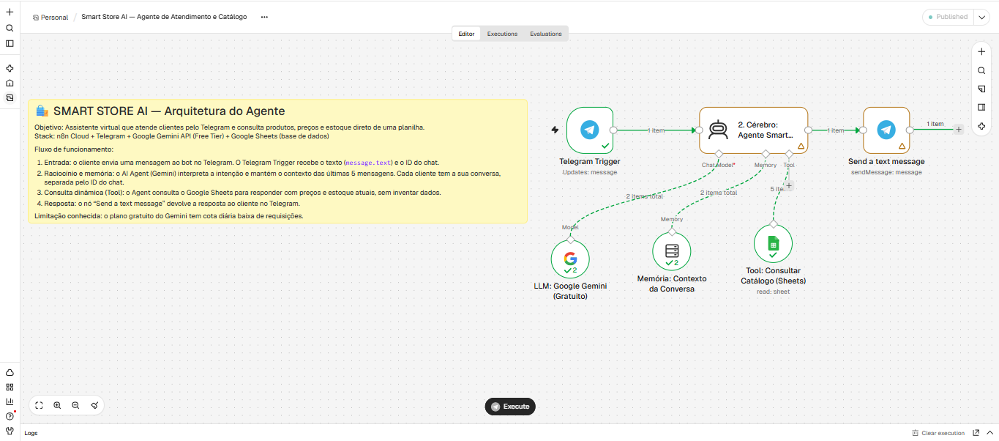
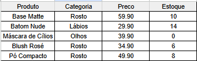

# 🤖 Smart Store AI — Agente de Atendimento e Consulta de Estoque em Tempo Real

Assistente virtual inteligente integrado ao **Telegram**, construído com **n8n**, **Google Gemini** e **Google Sheets**, desenvolvido para automatizar o atendimento comercial e eliminar erros de consulta de estoque e preços em tempo real.

---

## 🎯 Problema de Negócio
Pequenas e médias operações comerciais frequentemente sofrem com três gargalos operacionais:
1. **Perda de vendas por demora:** Clientes desistem quando aguardam minutos ou horas por uma resposta simples sobre preço ou disponibilidade.
2. **Erro operacional humano:** Risco de informar preços desatualizados ou vender itens já esgotados por falta de consulta imediata à planilha.
3. **Sobrecarga operacional:** Equipes gastam tempo respondendo perguntas repetitivas de catálogo em vez de focar em fechamento e casos complexos.

## 💡 A Solução
O **Smart Store AI** atua como uma camada inteligente entre a base de dados da loja e o cliente final:
* **Atendimento 24/7 em linguagem natural:** Interpreta perguntas abertas no Telegram sem exigir menus numéricos engessados.
* **Consulta a dados vivos (Zero Alucinação):** Antes de formular qualquer resposta, o agente consulta a base real no Google Sheets.
* **Regras comerciais automatizadas:**
  * *Produto disponível:* Informa o preço atualizado e a quantidade exata em estoque.
  * *Produto esgotado (`quantidade = 0`):* Informa a indisponibilidade e sugere proativamente alternativas disponíveis no catálogo.
  * *Produto inexistente:* Comunica claramente que o item não faz parte do portfólio da loja.
* **Gestão de contexto isolada:** Mantém o histórico das últimas 5 interações individualizado por `chat.id`, garantindo conversas contínuas sem misturar sessões de clientes diferentes.

---

## 🏗️ Arquitetura e Stack Tecnológica

* **Orquestração & Automação:** n8n Cloud
* **LLM (Processamento de Linguagem Natural):** Google Gemini API (`gemini-2.5-flash-lite` — escolhido pela baixa latência em tempo real)
* **Base de Dados:** Google Sheets (`Catalogo_Smart_Store_AI`)
* **Interface de Mensageria:** Telegram Bot API

### Fluxo de Execução
1. **Gatilho (`Telegram Trigger`):** Captura a mensagem enviada pelo cliente e identifica o `chat.id`.
2. **Raciocínio e Decisão (`AI Agent` + `Google Gemini`):** Interpreta a intenção do usuário com base nas diretrizes do *System Prompt*.
3. **Memória de Curto Prazo (`Simple Memory`):** Recupera o contexto recente daquela sessão específica.
4. **Consulta à Base (`Google Sheets Tool`):** Lê em tempo real as colunas `id_produto`, `produto`, `categoria`, `preco`, `quantidade_estoque` e `status`.
5. **Resposta (`Telegram Send Message`):** Envia a resposta limpa e formatada ao cliente em poucos segundos.

---

## 📊 Modelagem dos Dados (Google Sheets)
A base de dados foi estruturada de forma tabular para leitura rápida e precisa pelo agente:

| Coluna | Tipo | Descrição |
| :--- | :--- | :--- |
| `id_produto` | Texto/Int | Identificador único do item no catálogo |
| `produto` | Texto | Nome comercial do produto |
| `categoria` | Texto | Segmento do produto (ex: Maquiagem, Skincare) |
| `preco` | Decimal | Valor unitário atualizado |
| `quantidade_estoque` | Inteiro | Saldo físico disponível em tempo real |

---

## 🧪 Validação e Testes Realizados
* **Teste de Disponibilidade:** Consulta de preço e saldo exato de itens ativos.
* **Teste de Atualização Dinâmica (0 → 10):** Alteração manual do estoque de um item (*Base Matte*) de `0` para `10` unidades na planilha durante a conversa, validando que o bot reflete a mudança imediatamente na pergunta seguinte sem necessidade de reiniciar o fluxo.
* **Teste de Contorno (Estoque Zerado):** Solicitação de item esgotado (*Máscara de Cílios*), validando a recomendação automática de produtos substitutos disponíveis.

---

## 🚀 Como Reproduzir este Projeto
1. Faça o download do arquivo [`workflow.json`](workflow.json) neste repositório.
2. No seu painel do **n8n**, crie um novo workflow, clique no menu (`...`) e selecione **Import from File**.
3. Configure suas próprias credenciais nos nós de **Telegram**, **Google Gemini** e **Google Sheets**.
4. Crie uma planilha no Google Sheets seguindo a estrutura de colunas descrita acima e vincule ao nó de consulta.
5. Ative o workflow para **Production**.

---

## 👩‍💻 Autora
Desenvolvido por **Vitória** — Estudante de Análise de Dados, Automação e Inteligência Artificial.
